# Handleiding Kringo

Kringo tekent elektrische installaties in de browser, met twee apps: **🏠 Kringo Gebouw** (plattegronden, AREI-symbolen, kringen en het eendraadschema) en **⚙️ Kringo Besturing**: stuurkasten (industriële schema's) samen met hydraulica en pneumatica (ISO 1219-schema's), die je samen kunt simuleren. Hoofdstukken 3–6 gaan over Gebouw, 7–9 over Besturing. Deze handleiding legt uit hoe je werkt, met uitgewerkte voorbeelden.

> **Voorbeeldproject:** alle schermafbeeldingen komen uit het project [*Woning Voorbeeldstraat 1*](voorbeelden/Woning%20Voorbeeldstraat%201.kringo) – download het en open het in Kringo met **Open bestand**. Je vindt er alle voorbeelden uit deze handleiding in terug.

**Inhoud**

1. [Starten](#1-starten)
2. [Het scherm](#2-het-scherm)
3. [Gebouw: het grondplan tekenen](#3-gebouw-het-grondplan-tekenen)
4. [Gebouw: symbolen, kringen en koppelingen](#4-gebouw-symbolen-kringen-en-koppelingen)
5. [Het eendraadschema](#5-het-eendraadschema)
6. [Voorbeelden](#6-voorbeelden)
   - [A. Schakelaar met lampen (wisselschakeling)](#a-schakelaar-met-lampen-wisselschakeling)
   - [B. Ledstrip](#b-ledstrip)
   - [C. Zonnepanelen met omvormer](#c-zonnepanelen-met-omvormer)
   - [D. Zonnepanelen met DC-busbar, MPPT's en batterij](#d-zonnepanelen-met-dc-busbar-mppts-en-batterij)
   - [E. Domotica](#e-domotica)
   - [F. Een bestaand plan overtekenen (PDF als achtergrond)](#f-een-bestaand-plan-overtekenen-pdf-als-achtergrond)
   - [G. Ruimtes en uitwendige invloeden](#g-ruimtes-en-uitwendige-invloeden)
   - [H. Kabeltrace en kabellengtes](#h-kabeltrace-en-kabellengtes)
7. [Besturing: stuurkast](#7-besturing-stuurkast)
8. [Besturing: hydraulica en pneumatica](#8-besturing-hydraulica-en-pneumatica)
9. [Besturing: koelcircuits van machines](#9-besturing-koelcircuits-van-machines)
10. [Bewaren, openen, afdrukken](#10-bewaren-openen-afdrukken)
11. [Sneltoetsen](#11-sneltoetsen)

---

## 1. Starten

- **Online:** <https://gst84.github.io/kringo/> toont de keuze tussen **Kringo Gebouw** en **Kringo Besturing**; daarna opent dat adres meteen de laatst gebruikte app. Rechtstreeks: <https://gst84.github.io/kringo/gebouw/> en <https://gst84.github.io/kringo/besturing/> (Chrome, Edge of Safari).
- **Andere app:** klik op het **Kringo-logo** linksboven, of op de link onderaan het welkomscherm.
- **Als app:** open de app en klik in Chrome / Edge op *Installeren* in de adresbalk; op iPad / iPhone in Safari via deelknop → *Zet op beginscherm*. Elke app installeer je apart; wie er één installeert, kan beide zonder internet gebruiken.
- Bij het openen verschijnt het **welkomscherm**: kies de taal (Nederlands, Français, English), maak een **nieuw project** of open een recent project van deze app.
- Onder **Demoproject** open je een uitgewerkt voorbeeld: in Gebouw een **woning** (verlichting, stopcontacten, zonnepanelen, domotica, data, ruimtes, kabeltrace en eendraadschema), in Besturing een **besturing** (motorstarter, tijdrelais, noodstop, PLC, een elektrisch gestuurde cilinder, vier pneumatische / hydraulische schakelingen en de koeling van een spindel met een chiller). Het staat ook bovenaan in het venster **Project openen**. Elke keer krijg je een nieuwe kopie, dus je kunt er vrij in werken.

Projecten worden in de browser bewaard; elke app toont alleen zijn eigen projecten. Open je een project van de andere soort (bv. een `.kringo`-bestand van een stuurkast in Kringo Gebouw), dan gaat het vanzelf open in de juiste app. Oudere projecten van de soort *Hydraulica / pneumatica* openen in Besturing, met enkel pneumatische / hydraulische bladen.

## 2. Het scherm

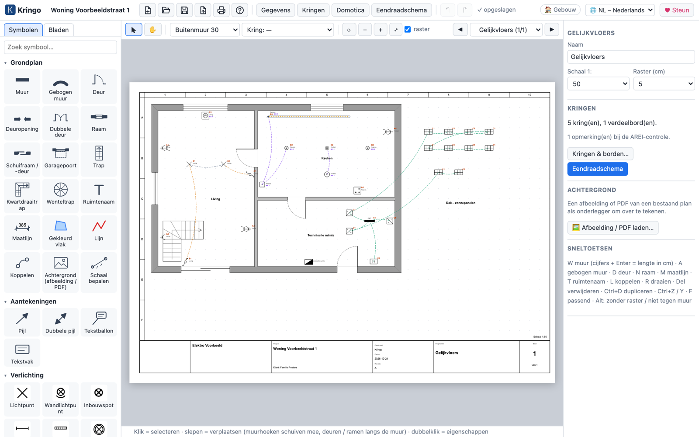

| Plaats | Wat |
|---|---|
| Bovenaan | Icoontjes: nieuw, openen, bewaren als bestand, bestand openen, afdrukken / PDF. Daarnaast *Gegevens*, *Kringen*, *Domotica*, *Eendraadschema*, ongedaan maken / opnieuw. Rechts de taal en ♥ Steun. |
| Werkbalk | Selecteren (muispijl), pannen, muurtype, actieve kring, draaien, zoomen, raster, en de **paginakeuze** met *Plattegronden* en *Eendraadschema* in één lijst. |
| Links | **Symbolen** (met de tekentools onder *Grondplan* en *Aantekeningen*) en **Bladen** (verdiepingen en eendraadbladen). |
| Rechts | **Eigenschappen** van wat geselecteerd is; zonder selectie die van de verdieping. |

Algemeen: klik = selecteren, Shift + klik = erbij selecteren, slepen = verplaatsen, dubbelklik = eigenschappen of tekst bewerken, scrollwiel = zoomen, spatie + slepen of middelste muisknop = pannen. **Enter** bevestigt in elk venster, **Esc** stopt een tool.

## 3. Gebouw: het grondplan tekenen

Alle tekentools staan links onder **Grondplan**.

### Muren

- **Muur** (`W`): klik punt na punt. Typ een lengte in cm en druk Enter voor een exacte maat. Klik op het beginpunt (of dubbelklik / Esc) om te stoppen. Kies vooraf het muurtype in de werkbalk (buitenmuur 30 / 40, binnenmuur 14 / 10, scheidingswand 7).
- **Gebogen muur** (`A`): klik het beginpunt, het eindpunt en dan een punt op de boog.
- Een geselecteerde muur heeft blauwe bolletjes: de **eindpunten** verlengen de muur (aansluitende muren schuiven mee, en binnenmuren die ertegen aansluiten blijven eraan vast), het **middelste** bolletje verschuift een rechte muur evenwijdig (hij blijft recht; aansluitende muren rekken mee). Met **Buigen** in de eigenschappen maak je er een gebogen muur van; bij een gebogen muur verandert het middelste bolletje de boog en maakt *Recht maken* hem terug recht.
- Muren die in een hoek samenkomen sluiten vanzelf netjes aan (verstek), ook tussen gebogen en rechte muren.

### Deuren, ramen en poorten

- Kies **Deur**, **Deuropening** (zonder deurblad), **Dubbele deur**, **Raam**, **Schuifraam / -deur** of **Garagepoort** en klik op een muur. De kant waar je muis staat bepaalt de draairichting.
- Verslepen schuift de opening langs de muur; de **blauwe bolletjes aan de uiteinden** maken ze breder of smaller.
- In de eigenschappen: type, breedte, hoogte, draairichting, scharnierzijde en *Zonder deurblad*.

### Trappen

- **Trap** en **Kwartdraaitrap**: sleep een rechthoek (of klik voor een standaardmaat). **Wenteltrap**: sleep vanuit het midden.
- Bolletjes aan de rand maken de trap groter of kleiner; de **draaischijf** in de eigenschappen draait hem rond zijn midden (sleep de wijzer, per 15°; Shift = per graad).

### Maten, vlakken en aantekeningen

- **Maatlijn** (`M`): klik twee punten (Kringo vangt muurhoeken en deurstijlen), dan de plaats van de maatlijn.
- **Gekleurd vlak**: klik de hoekpunten, klik het eerste punt of dubbelklik om te sluiten. Je ziet de oppervlakte in m².
- **Lijn**, **Pijl**, **Dubbele pijl**: klik de punten, dubbelklik of Enter = einde.
- **Tekstballon**: klik het punt waarnaar hij wijst, dan de plaats van de ballon, typ de tekst. **Tekstvak**: één klik.
- **Ruimtenaam** (`T`): klik in een ruimte en typ de naam.

### Uitlijnen en verdelen

Selecteer twee of meer symbolen of ruimtenamen (Shift-klik of een rechthoek slepen). In de eigenschappen staat dan de rij **Uitlijnen**: links, op één verticale lijn, rechts, boven, op één horizontale lijn, onder, en **horizontaal / verticaal gelijk verdelen**. Bij verdelen blijven het eerste en het laatste element staan; vul je *Afstand bij verdelen* in, dan krijgen ze die vaste afstand vanaf het eerste (links / boven).

### Achtergrond

Zie [voorbeeld F](#f-een-bestaand-plan-overtekenen-pdf-als-achtergrond).

## 4. Gebouw: symbolen, kringen en koppelingen

### Kringen en verdeelborden

Open **Kringen** bovenaan. Je bouwt er de boom: *verdeelbord → differentieel → kringen*, met differentiëlen achter differentiëlen en onderverdeelborden. Per kring stel je in: automaat of smeltzekering, curve, In, polen, Icn, kabel, brandklasse, aders, doorsnede, plaatsing en of de geleiders getekend worden. Opmerkingen van de AREI-controle staan meteen bij de kring.

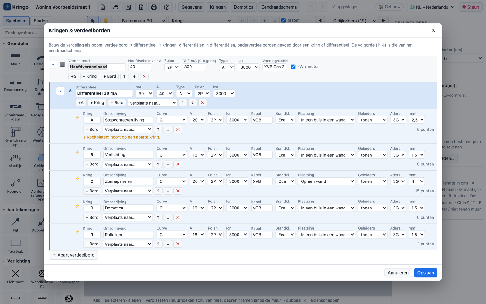

### Symbolen plaatsen

- Kies in de werkbalk de **actieve kring** (bv. *Kring A*). Nieuwe symbolen komen in die kring en krijgen een volgnummer: A1, A2 …
- Klik een symbool in het paneel en klik op het plan (of sleep het naar het plan). Wandsymbolen draaien vanzelf tegen de dichtstbijzijnde muur; `Alt` = vrij plaatsen.
- In de eigenschappen: kring, volgnummer, ruimte, omschrijving, montagehoogte, vermogen …

### Koppelen

**Koppelen** (`L`): klik de symbolen na elkaar: 1 → 2 → 3 … Opnieuw klikken op een gekoppeld paar ontkoppelt. Koppelingen verschijnen als gekleurde stippellijnen (oranje = schakelen, paars = domotica, groen = PV / DC).

- **Gekoppelde symbolen krijgen dezelfde kring en hetzelfde nummer** (een schakelaar en zijn lampen worden allemaal bv. B1). Pas je de kring of het nummer van één symbool aan, dan volgt de hele groep. Uitzondering: domotica-koppelingen.
- Gekoppelde symbolen komen in het eendraadschema samen in één aftakking.

### AREI-controle

Zonder selectie toont het eigenschappenpaneel de opmerkingen van de AREI-controle (max. 8 stopcontacten per kring, doorsnede ↔ automaat, symbolen zonder kring …).

## 5. Het eendraadschema

Klik bovenaan op **Eendraadschema** en daarna op *Genereren* (of Enter). Per verdeelbord komt een blad in de Belgische opbouw: hoofdrail met voeding en aarding, differentiëlen met hun rail, per kring de automaat, kabel en genummerde aftakkingen.

- Het schema wordt **niet automatisch bijgewerkt**: genereer opnieuw na wijzigingen (eerder gegenereerde bladen worden vervangen).
- De bladen staan in de paginakeuze onder *Eendraadschema* en kunnen achteraf nog aangepast worden.

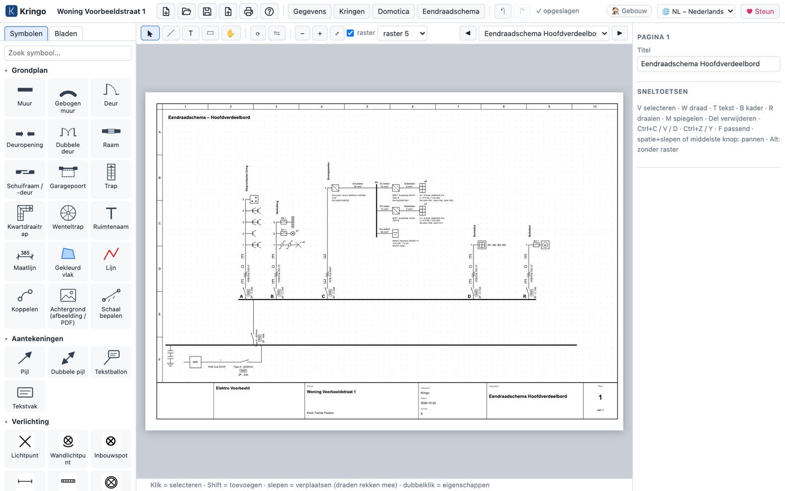

## 6. Voorbeelden

### A. Schakelaar met lampen (wisselschakeling)

Doel: een gang met twee wisselschakelaars die samen twee lichtpunten bedienen.

1. Open **Kringen** en maak (of kies) kring **B – Verlichting**, 16 A, 1,5 mm².
2. Kies in de werkbalk **Kring: B**.
3. Plaats bij elke deur een **Enkelpolige wisselschakelaar** (map *Schakelaars*) en in het plafond twee **Lichtpunten** (map *Verlichting*).
4. Kies **Koppelen** en klik: schakelaar 1 → lamp 1 → lamp 2 → schakelaar 2.
5. Alle vier krijgen hetzelfde nummer, bv. **B1**. In de eigenschappen van een lamp zie je de koppelingen en de melding *Geldt voor alle gekoppelde symbolen*.

   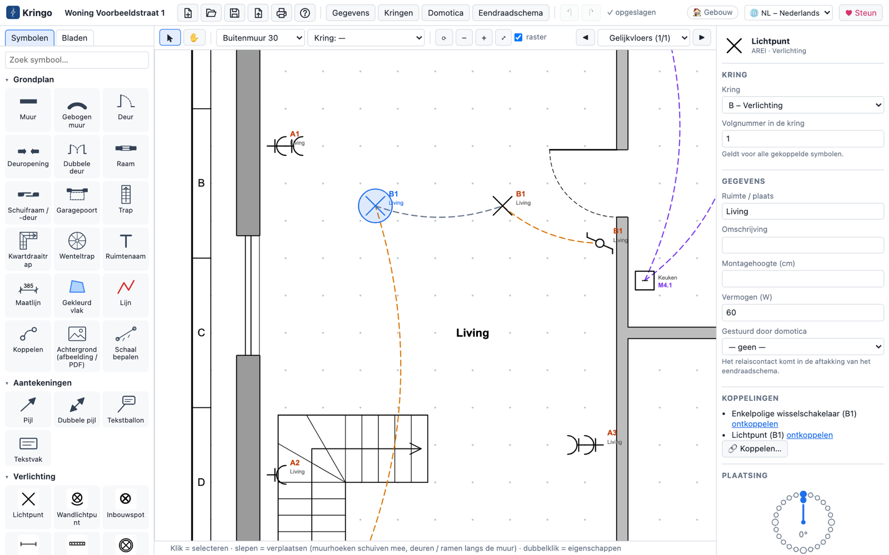

6. **Eendraadschema** → *Genereren*. In kring B staat één aftakking (1): wisselschakelaar – wisselschakelaar – lichtpunt **x2** (zie de afbeelding bij [voorbeeld E](#e-domotica)).

> Tip: een kruisschakelaar komt tussen de twee wisselschakelaars: koppel hem gewoon mee in de ketting.

### B. Ledstrip

Doel: een ledstrip van 4,5 m onder een keukenkast, bediend met een schakelaar.

1. Kies kring **B** als actieve kring.
2. Klik in de map *Verlichting* op **LED-strip** en klik de punten van de strip op het plan. Het **eerste punt** (donker bolletje) is de voeding. Dubbelklik of Enter = einde.
3. In de eigenschappen zie je de **lengte** en het **vermogen**; vul *Vermogen per meter* (bv. 10 W/m) en de *Spanning* (24 V) in.
4. Plaats een schakelaar en **koppel** schakelaar → ledstrip.
5. In het eendraadschema: schakelaar → LED-strip in één aftakking.

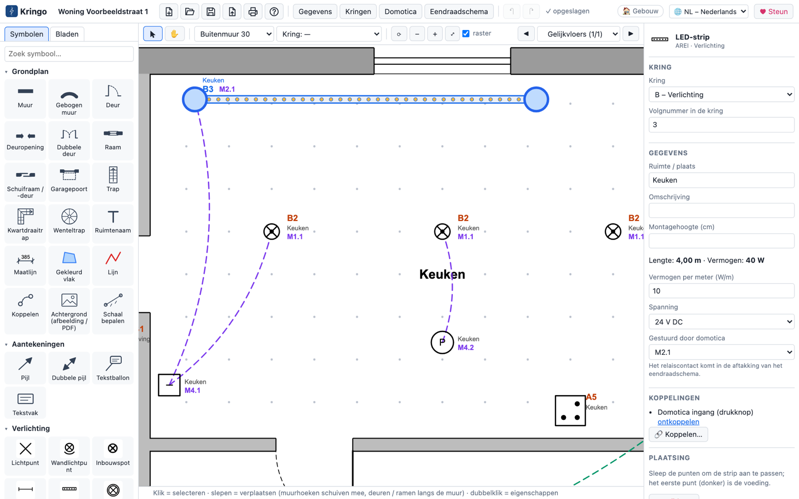

In de voorbeeldwoning hangt de ledstrip niet aan een schakelaar maar aan domotica-kanaal **M2.1** (zie [voorbeeld E](#e-domotica)).

**RGB / RGBW**: kies bij *Type* **RGB** of **RGBW**. De leds op het plan kleuren dan rood, groen, blauw (en wit). Op domotica krijgt elke kleur een eigen **dimmerkanaal**: kies het kanaal voor rood en de andere kleuren krijgen automatisch de volgende vrije kanalen (aan te passen). In het eendraadschema staat het relaiscontact met het hele bereik, bv. **M2.1–4 RGBW**; in het venster Domotica zie je per kanaal de kleur (*LED-strip (Rood)* …).

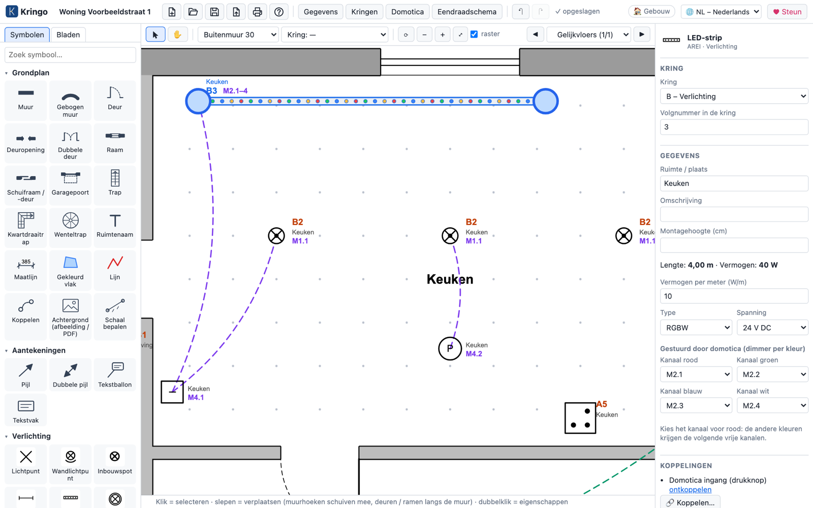

### C. Zonnepanelen met omvormer

Doel: 10 panelen op één omvormer, op een eigen kring.

1. Maak in **Kringen** een kring **P – Zonnepanelen** (bv. 2P C 20 A, XVB 3G4²).
2. Plaats de **Omvormer** (map *Energie*) aan een muur en de **Zonnepanelen** op het dak. Eén paneelsymbool mag meerdere panelen voorstellen: zet *Aantal panelen* in de eigenschappen.
3. **Koppel**: omvormer → paneel 1 → paneel 2 → …
4. Vul bij de omvormer *Type / model*, *Serienummer* en *Vermogen (kW)* in, bij de panelen *Type*, *Piekvermogen (Wp)* en eventueel serienummers.
5. Klik op het plan op de omvormer: onder **Koppelingen** staat bij het eerste paneel een veld *kabeltype*: kies bv. **Solarkabel 6 mm²**.
6. Eendraadschema: één aftakking **omvormer → panelen x10**, met de kabel boven de lijn en onder elk symbool de gegevens – zoals in [voorbeeld D](#d-zonnepanelen-met-dc-busbar-mppts-en-batterij), maar zonder busbar.

### D. Zonnepanelen met DC-busbar, MPPT's en batterij

Doel: een hybride installatie: een omvormer/lader, twee MPPT-laadregelaars met elk hun panelen en een thuisbatterij, allemaal op een DC-busbar.

**Op het plan**

1. Plaats in de technische ruimte: **Omvormer**, **DC-busbar**, twee keer **MPPT-laadregelaar** en de **Thuisbatterij** (map *Energie*); de **Zonnepanelen** op het dak.
2. **Koppel** (`L`) zo:
   - omvormer ↔ DC-busbar
   - MPPT 1 ↔ DC-busbar, MPPT 2 ↔ DC-busbar
   - batterij ↔ DC-busbar
   - MPPT 1 ↔ paneel 1 → paneel 2 → … (de panelen onderling in een ketting)
   - MPPT 2 ↔ zijn eigen panelen
3. Vul de gegevens in (eigenschappen rechts):
   - omvormer: type, serienummer, vermogen (kW)
   - MPPT: type, serienummer, vermogen (W) en/of max. laadstroom (A)
   - batterij: type, serienummer, capaciteit (kWh), vermogen (kW)
   - panelen: type, piekvermogen (Wp), serienummers
4. **Kabels**: klik een toestel aan en vul onder **Koppelingen** het *kabeltype* in (of klik op de groene stippellijn zelf):

   | Kabel | Op de koppeling | Bijvoorbeeld |
   |---|---|---|
   | omvormer → busbar | omvormer ↔ busbar | Accukabel 25 mm² |
   | busbar → MPPT | MPPT ↔ busbar | DC-kabel 10 mm² |
   | busbar → batterij | batterij ↔ busbar | Accukabel 25 mm² |
   | MPPT → panelen | MPPT ↔ eerste paneel | Solarkabel 6 mm² |

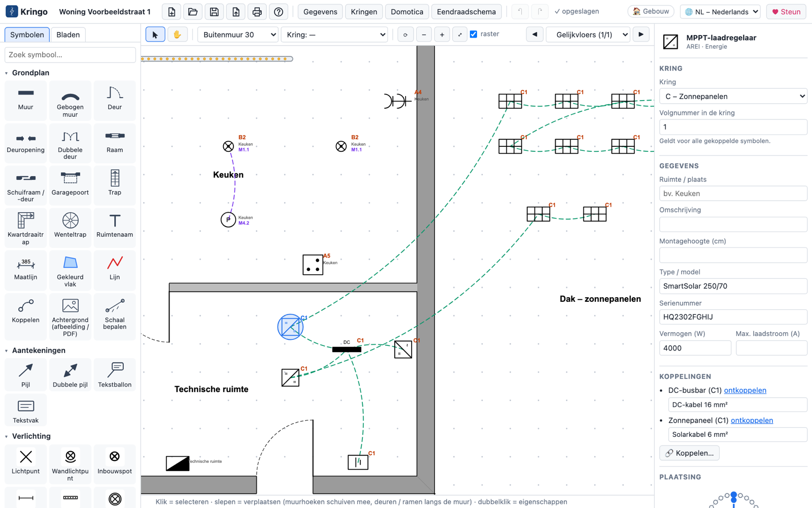

**In het eendraadschema** wordt dat één aftakking: de omvormer op de kringlijn, dan de verticale **DC**-busbar, met per toestel een rij. De MPPT met panelen komt bovenaan, de andere MPPT en de batterij parallel eronder. Boven elke lijn staat de kabel, onder elk symbool het type, het vermogen en de serienummers:

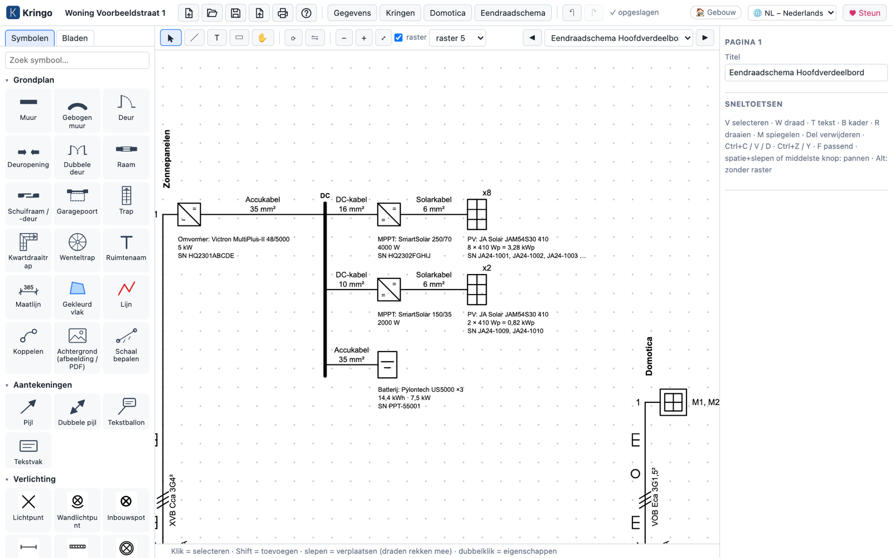

### E. Domotica

In een domotica-installatie zitten de **modules (relais, dimmers, rolluikmodules) in het verdeelbord**; op het plan staan alleen de drukknoppen, sensoren en de verbruikers.

Doel (zoals in de voorbeeldwoning): drie inbouwspots in de keuken op een schakelmodule, een gedimde ledstrip, een rolluik in de living, een domotica-drukknop en een aanwezigheidsmelder.

1. **Modules aanmaken**: klik bovenaan op **Domotica**.
   - *＋ Schakelmodule* → **M1**, zet *Kanalen* op 8 (instelbaar van 1 tot 32), kies het *Bord* en de *Voeding* (de kring die de modules voedt, bv. kring D).
   - *＋ Dimmermodule* → **M2**, 4 kanalen.
   - *＋ Rolluikmodule* → **M3**, 3 kanalen.
   - *＋ Ingangsmodule* → **M4** voor de drukknoppen (optioneel).
2. **Verbruikers tekenen**: lichtpunten, ledstrip en de **Rolluik / screen (motor)** (map *Toestellen*), elk in hun kring (bv. B voor verlichting, R voor rolluiken).
3. **Kanalen toewijzen** – op twee manieren:
   - bij het symbool: eigenschappen → **Gestuurd door domotica** → kies bv. *M1.1*;
   - of centraal in het venster **Domotica**: bij een kanaal *＋ toewijzen…*.

   Meerdere lampen op hetzelfde kanaal mag. Op het plan verschijnt het adres in paars naast het symbool (bv. **M1.1**).
4. **Drukknoppen**: plaats **Domotica ingang (drukknop)**, **Domotica bewegingsmelder** of **Domotica aanwezigheidsmelder** (map *Domotica*). Kies eventueel bij *Domotica-ingang* een kanaal van de ingangsmodule (M4.1 …). **Koppel** de drukknop aan de lampen die hij bedient: dat is alleen informatie (welke knop wat stuurt); de kring wordt niet overgenomen, want drukknoppen zitten op de bus.

   | Kanaal | Stuurt | Bediening |
   |---|---|---|
   | M1.1 | B2 Inbouwspot ×3 – Keuken | M4.1 drukknop, M4.2 aanwezigheidsmelder |
   | M2.1 | B3 LED-strip – Keuken | M4.1 drukknop |
   | M3.1 | R1 Rolluik – Living | – |

5. **CSV exporteren** in het venster Domotica geeft deze lijst voor de programmeur.

   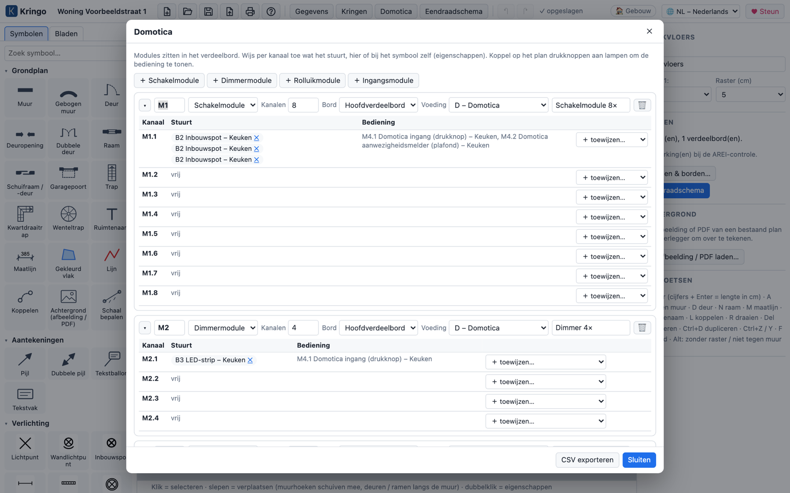

6. **Eendraadschema**: in elke aftakking komt het **relaiscontact met zijn adres** vóór de verbruikers; de kring die de modules voedt krijgt een **modulevak** met hun namen. Drukknoppen komen niet in het 230 V-schema.

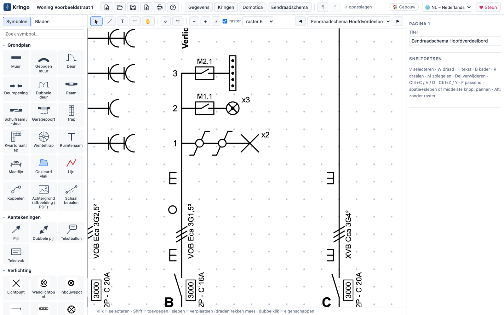

### F. Een bestaand plan overtekenen (PDF als achtergrond)

1. Kies onder *Grondplan* **Achtergrond (afbeelding / PDF)** en open het bestand (een PDF wordt eenmalig met internet omgezet; bij meerdere pagina's kies je de pagina).
2. Bij een PDF vraagt Kringo de **schaal** (bv. 50 voor 1:50): dan krijgt het plan meteen zijn echte maat. Laat leeg om de schaal zelf te bepalen.
3. **Schaal bepalen**: klik twee punten waarvan je de afstand kent (bv. de buitenmaat van een gevel) en geef de werkelijke afstand in cm.
4. Sleep de achtergrond op zijn plaats, zet de *Dekking* op 30–50 % en **vergrendel** hem.
5. Teken de muren erover. Kies *Mee afdrukken* als de achtergrond op de afdruk moet.

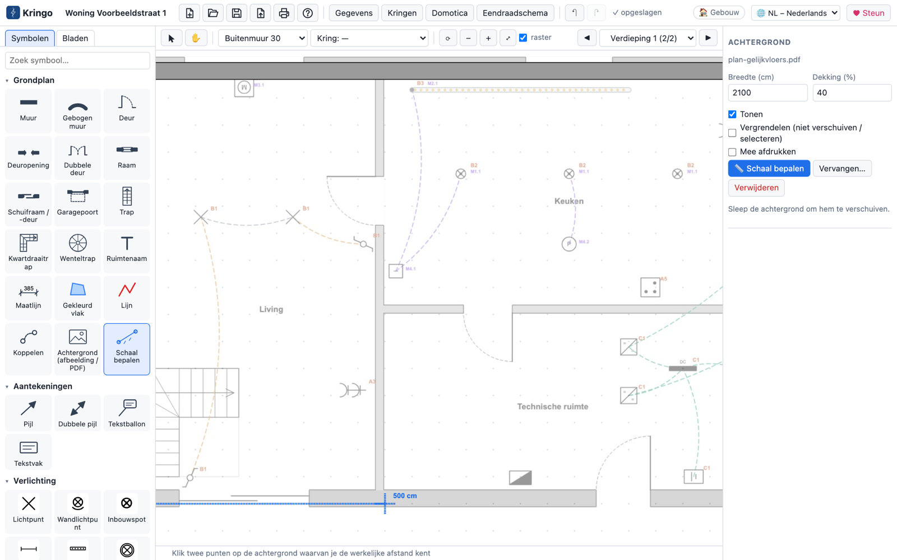

### G. Ruimtes en uitwendige invloeden

Het AREI (Boek 1, 2.10) vraagt de **uitwendige invloeden** per ruimte: omgevingstemperatuur (AA), water (AD), vreemde lichamen (AE) … tot structuur van gebouwen (CB), plus of de ruimte publiek toegankelijk is. Kringo maakt daar het document van.

1. **Ruimtes tekenen** (onder *Grondplan*):
   - **Ruimte**: klik in een kamer. Kringo zoekt de omtrek tussen de muren; verplaats je later een muur, dan past de ruimte zich aan.
   - **Ruimte (hoeken)**: voor ruimtes zonder muren rondom (open keuken, buiten). Klik de hoeken: ze snappen op elke hoek van de muuromtrek (ook waar een binnenmuur een buitenmuur of een andere binnenmuur raakt) en op de muurvlakken. Zo'n hoek blijft aan de muren hangen en beweegt mee; Alt = vrij plaatsen. Sluit met het eerste punt, dubbelklik of Enter.
   - **Ruimtescheiding**: een stippellijn die je tekent zoals een muur. Ze splitst een open ruimte (bv. zithoek en open keuken) zodat **Ruimte** elk deel apart vindt, en **Ruimte (hoeken)** snapt er ook op. Kabels lopen er gewoon door en er kunnen geen deuren of ramen in. Een bestaande muur kan je via *Soort* ook omzetten naar een ruimtescheiding.
2. Geef een **naam**. Uit de naam kiest Kringo een **sjabloon** (keuken, badkamer, garage, technische ruimte, terras …) dat de codes invult; dat kan je achteraf wijzigen.
3. In de eigenschappen klap je een code open en klik je de **klassen** aan (groen = gekozen), elk met hun omschrijving – meerdere tegelijk mag (bv. AA 4, 5 en 8). Codes die afwijken van een normaal lokaal zijn gemarkeerd en staan op het plan onder de naam en de oppervlakte.
   Met **★ Opslaan als sjabloon…** bewaar je de instellingen van een ruimte (codes, publiek toegankelijk, kleur) als eigen sjabloon. Het staat dan met ★ in de lijst, in elk project op deze computer, en wordt ook in het project zelf bewaard. Een nieuwe ruimte waarvan de naam het sjabloon bevat, krijgt het automatisch. **Sjabloon verwijderen** haalt het weg; ruimtes houden hun waarden.

   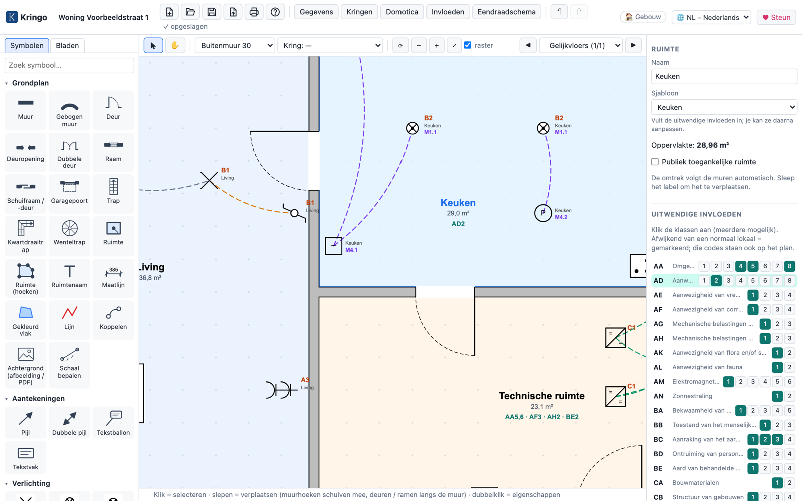

4. **Invloeden** bovenaan toont de tabel van alle ruimtes met referentie, datum en adres. **CSV exporteren** geeft de lijst voor Excel; **Blad genereren** maakt het A3-blad zoals het Normec-overzicht, met vakken voor de handtekeningen van de exploitant en het erkend organisme.

   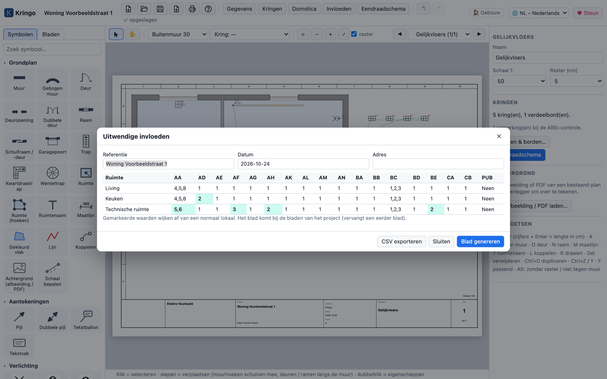

   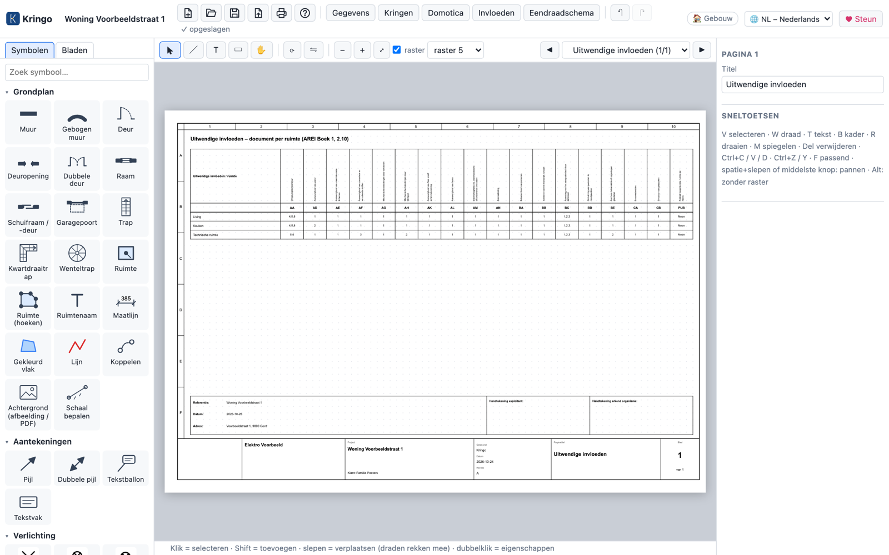

> De sjablonen zijn een vertrekpunt. De uitwendige invloeden worden bepaald door de uitbater en nagekeken door het erkend organisme – pas ze aan aan de werkelijke situatie.

### H. Kabeltrace en kabellengtes

1. Zet een **Verdeelbord** (Energie) op het grondplan. Met meerdere borden kies je in de eigenschappen van het symbool welk bord het is.
2. Klik bovenaan op **Kabels** en dan op **Kabeltrace genereren**. Per kring loopt een route van het verdeelbord naar het eerste punt en daarna van punt naar punt, in de volgorde van de nummers (bij hetzelfde nummer eerst de schakelaar, dan de lampen). Elk domotica-uitgangskanaal krijgt een eigen kabel vanaf het bord. De DC-kant van zonnepanelen telt niet mee.
3. De kabels gaan enkel door **deuren, deuropeningen, schuifdeuren en garagepoorten** – niet door muren of ramen, en niet buiten het gebouw om. De kabels lopen met rechte hoeken, liefst op 20–30 cm van de muren, en waar ze dezelfde weg nemen liggen ze mooi gebundeld naast elkaar. Elke kring krijgt een kleur; de kabel vanaf het bord is dikker en draagt de naam van de kring. Met het vinkje **kabels** in de werkbalk zet je de overlay aan of uit.

   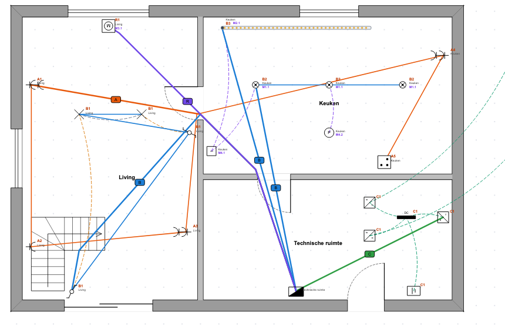

4. De lengte = de route op het plan + de verticale stukken naar elke doos (hoogtes onder **Hoogtes en reserve**: verdeelbord, stopcontacten, schakelaars, wandverlichting, toestellen, plafond, verdiepingshoogte) + een extra stuk per aansluiting + de reserve in %. Plafondpunten worden via het plafond bereikt, de andere via de vloer. Een punt kan een eigen **Hoogte (cm)** krijgen in zijn eigenschappen. Punten op een andere verdieping lopen via een stijgleiding op de plaats van het verdeelbord.
5. Het type kabel komt uit de kring (bv. VOB Eca 3G2,5²). Je krijgt een lijst **per kabeltype** en **per kring**, ook als CSV.
6. **Data en bus** (gestreepte lijnen): elke **Datacontactdoos** krijgt een eigen **datakabel** vanaf de dichtstbijzijnde **Patchkast** (map *Diversen*; zonder patchkast vanaf het verdeelbord). De **buskabel** loopt vanaf het verdeelbord langs alle domotica-drukknoppen en -sensoren, telkens naar de dichtstbijzijnde volgende. Ze hebben geen kring nodig en staan als *Datakabel* en *Buskabel* in de lijst.

   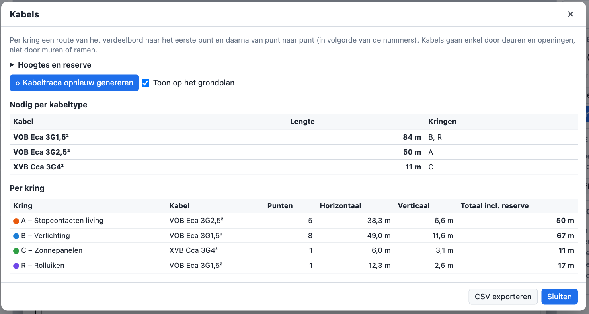

> Het is een schatting: de routes volgen een raster van 10 cm door de ruimtes. Wijzig je het plan of de kringen, dan meldt Kringo dat je opnieuw moet genereren.

## 7. Besturing: stuurkast

Een besturingsproject heeft drie soorten bladen. In de lijst **Pagina's** staan ze in groepen: **⚡ Elektrisch**, **💧 Hydraulica / pneumatica** en **❄ Koeling**; met de **＋** naast een groep voeg je een blad van die soort toe. De bibliotheek toont enkel de symbolen die bij het actieve blad horen: *Standaard* en *AREI* op elektrische bladen, *Pneumatica* en *Hydraulica* op pneumatische / hydraulische bladen, *Koeling* op koelbladen. Toestellen op die laatste krijgen een eigen codering (standaard `{prefix}{n}` → *V1*, *A1*; in *Instellingen*).

- **Pagina's** op A3 met kolommen en rijen, titelblok met bedrijf en logo (*Gegevens*).
- **Voedingslijnen** (L1 L2 L3 N PE, +24V / 0V …) in de pagina-eigenschappen; zelfde naam = zelfde potentiaal over alle pagina's.
- **Draad** (`W`): klik op een pin, knikpunten, eindigt vanzelf op een pin, draad of voedingslijn.
- **Koppelen** van contacten aan een spoel of drukknop: gedeelde tag, kruisverwijzing (/2.4) en contactspiegel.
- **Lijsten**: toestellen, klemmen, draden, PLC – CSV en afdrukken.
- **Symbooleditor** voor eigen symbolen; symbolen importeren / exporteren of een map op schijf koppelen.
- **QElectroTech**: *Open bestand* opent ook `.qet`-projecten.

### Simuleren

- Klik **▶ Simuleren** in de werkbalk. Het blad krijgt een groene rand en kan niet bewerkt worden.
- Klik op een **drukknop** om hem in te drukken (zolang je de muis inhoudt), **Shift+klik** houdt hem vast. Noodstop, keuzeschakelaar en sleutelschakelaar wisselen bij elke klik.
- **Actieve lijnen gloeien groen**: draden onder spanning, bekrachtigde spoelen en bediende contacten; lampen branden geel. Contacten volgen hun spoel (ook met opkom- of afvalvertraging), beveiligingen en klemmen geleiden.
- De voeding komt van de voedingslijnen: *L, L1–L3, +24V* zijn de plus, *N, 0V* de min.
- **⏸** pauzeert, **⟲** zet alles terug in de beginstand, de snelheid kies je van ¼× tot 2×, **■ Stop** of `Esc` stopt. Wijzig je iets aan het schema, dan stopt de simulatie.

## 8. Besturing: hydraulica en pneumatica

Pneumatische en hydraulische schema's teken je op de bladen van de groep **💧 Hydraulica / pneumatica** van een besturingsproject. Het demoproject **Besturing** heeft er vijf: een elektrisch gestuurde cilinder (zie *Elektrisch sturen* hieronder), automatische terugloop (drukknopventiel, 5/2-impulsventiel, rolventiel, smoor-terugslagventielen), tweehandbediening met een EN-ventiel, hydraulisch heffen (aggregaat, drukbegrenzer op 40 bar, filter, 4/3-hendelventiel) en een pendelbeweging met pulsteller.

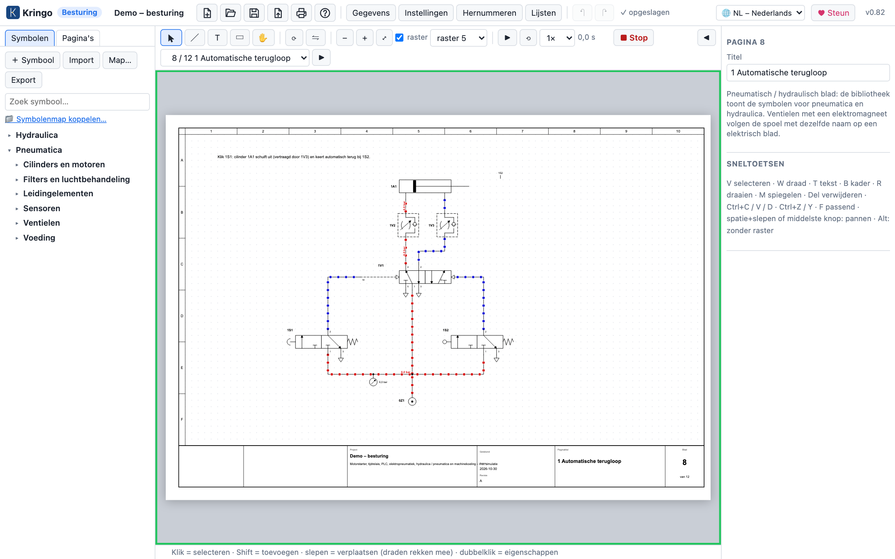

**Tekenen**

- De symbolen (ISO 1219) staan in de mappen **Pneumatica** en **Hydraulica**: ventielen; cilinders en motoren (enkel- en dubbelwerkend, veer links of rechts, doorgaande zuigerstang, eindstanddemping, instelbaar, magnetische zuiger, telescoopcilinders, zwenkaandrijving, drukverhogers en omvormers); voeding (drukluchtbron, energiebron, compressor, luchtketel, onderhoudseenheid, hydraulisch aggregaat); filters en luchtbehandeling (filters, waterafscheiders, droger, olievernevelaar, onderhoudseenheden); warmtewisselaars (verwarmer, koeler, temperatuurregelaar); tanks en accumulatoren; leidingelementen; sensoren (manometers, drukindicator, thermometer, niveaumeter, debietmeters, drukschakelaar, eindschakelaar, pulstellers). Leidingen teken je met het draadgereedschap (`W`).
- **Ventielen** zijn instelbaar in de eigenschappen: type (2/2, 3/2, 4/2, 5/2, 4/3, 5/3), bediening links en rechts (veer, hand, drukknop, hendel, rol, pneumatisch / hydraulisch gestuurd, elektromagneet) en de middenstand (gesloten, ontlucht, belucht, vrijloop, tandem, open). De poorten staan op de ruststand.
- **Cilinders**: uitvoering, zuigerstang, demping, slag (mm), tijd voor de volle slag (s) en **markeringen**, bv. `1S1=0; 1S2=100`. Een **rolventiel** of **eindschakelaar** met de naam van een markering (bv. tag *1S2*) wordt bediend als de zuigerstang daar staat.

**Elektrisch sturen**

De simulatie loopt over alle bladen tegelijk, dus de elektrische bladen sturen de pneumatiek en hydraulica aan:

- Een ventiel met **elektromagneet** schakelt als de spoel met dezelfde naam onder spanning staat, bv. *Spoel links* = `-5Y3` volgt het magneetventiel (symbool *Magneetventiel*) met tag *-5Y3* op een elektrisch blad. De keuzelijst bij het veld toont de spoelen in het project.
- Een **eindschakelaar** (maak / verbreek) op een elektrisch blad volgt de **markering** van een cilinder met dezelfde naam (veld *Markering*), en een contact gekoppeld aan een **drukschakelaar** schakelt op de druk.
- Voorbeeld in het demoproject: op *Elektropneumatiek – sturing* zet **Start** relais K onder spanning (zelfhouding); K bekrachtigt de spoel van ventiel 5V1 op *Elektropneumatiek – cilinder*, de cilinder schuift uit tot de eindschakelaar (verbreek) K laat afvallen, en de veer zet het ventiel terug.

**Simuleren**

- **▶ Simuleren** werkt zoals bij de stuurkast. Klik **links of rechts op een ventiel** om die kant te bedienen (hand, drukknop, hendel of spoel); Shift = vasthouden. Gestuurde ventielen schakelen op druk, rolventielen op de cilindermarkeringen.
- Op de leidingen onder druk en de **retourleidingen** (open naar de afvoer of tank) staan **bolletjes** in een kleur van **blauw** (0 bar) tot **rood** (hoogste druk, apart voor pneumatica en hydraulica); op leidingen onder druk staat ook de **druk**. Waar het medium stroomt – van de bron naar een bewegende cilinder of motor en van de andere kamer naar de afvoer – lopen de bolletjes in de stroomrichting, even snel als de zuiger beweegt; elders en op zijtakken staan ze stil.
- Ventielen verschuiven, zuigers en motoren bewegen, manometers tonen hun druk en pulstellers tellen.
- Smoorventielen vertragen de beweging (meter-out met een smoor-terugslagventiel werkt zoals verwacht); OF- en EN-ventielen, drukregelaar, drukbegrenzer en drukverhoger werken ook.

> De simulatie is functioneel (zoals de eenvoudige modus van FluidSIM): druk aan / uit en de ingestelde druk, geen krachten of debieten. Accumulatoren, warmtewisselaars en meetinstrumenten zonder druk zijn enkel getekend. Ze is zo opgebouwd dat een fysisch model later kan volgen.

## 9. Besturing: koelcircuits van machines

Koelcircuits teken je op de bladen van de groep **❄ Koeling**: het koelwater (of glycol) van een machine én de koelmiddelkring van een chiller. Het demoproject **Besturing** heeft er een voorbeeld van: *Koelwater spindel met chiller*, gestuurd vanaf het elektrische blad *Koeling – sturing*.

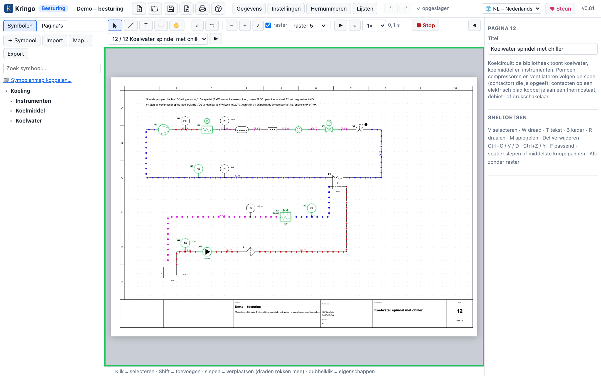

**Symbolen** (map *Koeling*)

- **Koelwater:** pomp, open reservoir, expansievat, filter, vuilvanger, verbruiker / warmtebron (spindel, kast, matrijs …), koelradiator (passief), luchtkoeler / droge koeler met ventilator, koelaggregaat (chiller als geheel), platenwarmtewisselaar, kogelkraan, magneetventiel, driewegklep (motor of thermostatisch), terugslagklep, ontluchter en aftapkraan.
- **Koelmiddel:** compressor, condensor (lucht- of watergekoeld), verdamper (luchtkoeler of watergekoeld), thermostatisch expansieventiel, capillair, magneetventiel, afsluiter, terugslagklep, filterdroger, kijkglas, vloeistofvat en zuiggasafscheider.
- **Instrumenten** (P&ID-bol op de leiding): thermostaat **TS**, debietschakelaar **FS**, niveauschakelaar **LS**, hoge- en lagedrukpressostaat **PSH** / **PSL**, thermometer **TI**, manometer **PI** en debietindicator **FI**.

In-lijnonderdelen hebben links en rechts een aansluiting; warmtewisselaars, watergekoelde condensors en verdampers hebben er vier (boven het ene medium, onder het andere). Leidingen teken je met het draadgereedschap (`W`).

**Elektrisch sturen**

- Bij een **pomp**, **compressor** of **ventilator** vul je in door welke spoel (contactor) hij aangestuurd wordt, bv. `-6K2`; de keuzelijst toont de spoelen in het project. Een ventilator zonder spoel draait altijd.
- Een **magneetventiel** of **motordriewegklep** volgt de spoel met dezelfde naam (symbool *Magneetventiel* op een elektrisch blad).
- Een **contact** (maak / verbreek) op een elektrisch blad koppel je met *Koppelen aan toestel* aan een thermostaat, debiet-, niveau- of drukschakelaar.

**Vermogens en temperaturen**

| Onderdeel | Instellingen |
|---|---|
| Pomp | debiet (l/min), koelmiddel (water, glycol 30 % of 50 %) |
| Reservoir | inhoud (l), begintemperatuur (°C) |
| Verbruiker (warmtebron) | warmtevermogen (kW) |
| Chiller (als geheel) | koelvermogen (kW), vertrektemperatuur (°C) |
| Koelradiator (passief) | koelvermogen bij 10 K verschil met de lucht (kW), luchttemperatuur (°C) – het vermogen daalt naarmate het water de luchttemperatuur nadert, het water wordt nooit kouder dan de lucht |
| Luchtkoeler / droge koeler | koelvermogen (kW), luchttemperatuur (°C) – koelt tot ca. 3 K boven de lucht |
| Verdamper (watergekoeld) | koelvermogen (kW) – koelt tot ca. 2 K boven de verdampingstemperatuur |
| Condensor (watergekoeld) | warmteafgifte aan het koelwater (kW) |
| Platenwarmtewisselaar | rendement ε |
| Compressor | verdampings- en condensatietemperatuur (°C) |
| Thermostaat (TS) | schakeltemperatuur (°C), hysterese (K), warm of koud |

Debiet, vermogens en inhoud staan ook bij het symbool. Elk onderdeel verandert de watertemperatuur met ΔT = P / (ṁ · cp); het reservoir en de pomp hebben een inhoud, dus de temperaturen stijgen en dalen in de tijd. Kies een snelheid van 5× of 10× om een volledige koelcyclus te volgen.

**Simuleren**

- Een draaiende pomp laat het water stromen door alle leidingen die op een open weg van de pers- naar de zuigzijde liggen; bij een aftakking verdeelt het debiet zich, bij een samenkomst mengt het water.
- Op elke stromende leiding staat de **temperatuur**, en **stroombolletjes** lopen over de leiding in de richting van de stroming. Hun kleur loopt van **blauw** (koudste leiding) naar **rood** (warmste), apart voor het koelwater en het koelmiddel; hun snelheid volgt het debiet van de pomp (en de simulatiesnelheid). Ook een leiding die tegen de stroomrichting in getekend is, toont de juiste richting.
- In de koelmiddelkring is alles van de compressor tot het expansieventiel de **hogedrukzijde** (persgas, vloeistofleiding), de rest de **lagedrukzijde** (na het expansieventiel, zuigleiding).
- **Afpompen:** sluit het magneetventiel terwijl de compressor draait, dan daalt de zuigdruk en valt de lagedrukpressostaat af; gaat het ventiel weer open, dan stijgt de druk en start de compressor opnieuw. Een compressor zonder werkende condensor (ventilator uit, geen koelwater) bouwt een hogedrukstoring op.
- Klik op een pomp, compressor of klep om ze met de hand te bedienen, op een **verbruiker** om de machine stil te zetten, op een **niveauschakelaar** om een te laag niveau na te bootsen. Een verbruiker zonder debiet kleurt rood.
- De thermostaat meet met een kleine vertraging (zoals een voeler in een dompelhuls) en schakelt met hysterese; debiet- en drukschakelaars schakelen met een korte vertraging. Plaats de thermostaat bij voorkeur op het reservoir of de zuigleiding van de pomp: na een verbruiker of verdamper verandert de temperatuur te snel.

> De berekening is een eenvoudige warmtebalans: vaste debieten, geen drukval of warmteverlies in leidingen, en in de koelmiddelkring vaste verdampings- en condensatietemperaturen.

## 10. Bewaren, openen, afdrukken

- Projecten worden **automatisch** in de browser bewaard.
- **Bewaar bestand** (diskette) maakt een `.kringo`-bestand om door te sturen of als back-up; **Open bestand** opent `.kringo` en `.qet`.
- **Afdrukken / PDF** (printer): kies alles, alle plattegronden, de huidige plattegrond of het eendraadschema; kies in het afdrukvenster *Opslaan als PDF* en zet de marges op *Geen*. Alles op A3 liggend, plattegronden op schaal.

## 11. Sneltoetsen

**Grondplan:** `W` muur · `A` gebogen muur · `D` deur · `N` raam · `M` maatlijn · `T` ruimtenaam · `L` koppelen · `R` draaien · `V` selecteren · `H` pannen · `Del` verwijderen · `Ctrl+D` dupliceren · `Ctrl+Z / Y` ongedaan / opnieuw · `F` passend · `Alt` zonder raster / niet tegen de muur · `Backspace` laatste punt terug (vlak, lijn, ledstrip).

**Stuurkast:** `V` selecteren · `W` draad · `T` tekst · `B` kader · `R` draaien · `M` spiegelen · `Ctrl+C / X / V / D` · `Ctrl+Z / Y` · `F` passend · `PgUp / PgDn` pagina.

**Tablet:** knijpen = zoomen, twee vingers = verschuiven, lang drukken = rechtermuisknop.
